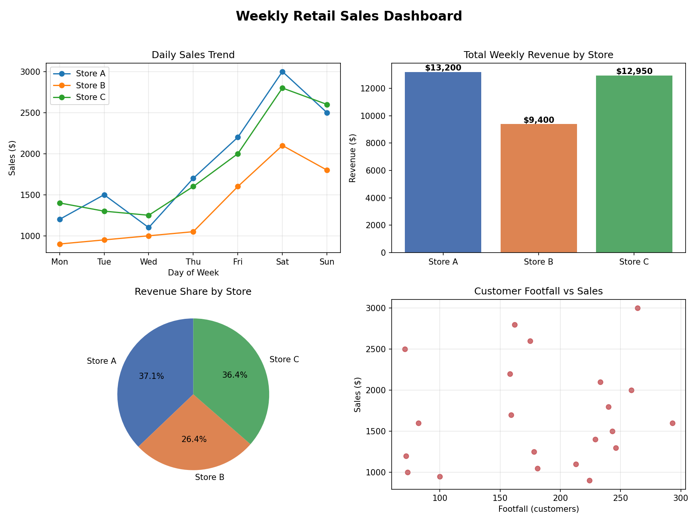
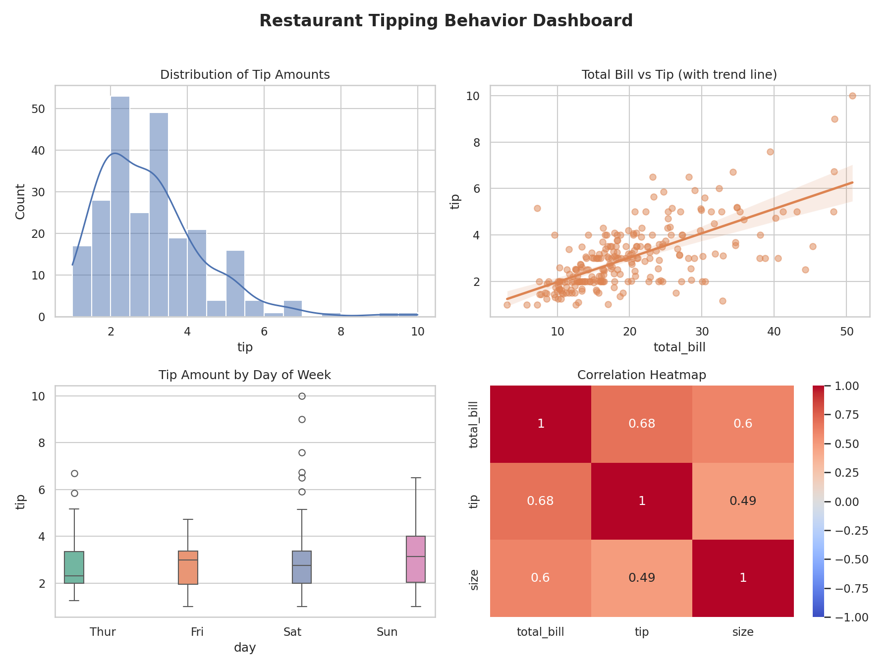

# Module 2: Python Programming for AI

← [Module 1](../module-01-intro-to-ai) · [Course home](../README.md) · 📒 [Notes on Notion](https://chipped-willow-4a2.notion.site/4066f1ed006e810e9bf3eadfd1c09a5a) · Next: Module 3 (coming soon)

## What you'll learn

- Variables, data types, operators, conditions and loops
- Lists, tuples, sets and dictionaries (and the `list_b = list_a` trap)
- Functions and exception handling
- File handling with `with open(...)`
- Object-oriented programming: classes and objects
- The AI data stack: **NumPy**, **Pandas**, **Matplotlib** and **Seaborn**

## Videos

Coming soon. Until then, read the [Notion notes](https://chipped-willow-4a2.notion.site/4066f1ed006e810e9bf3eadfd1c09a5a) and run the code below.

## Hands-on lab

Four runnable scripts tell one story: a week of sales across 3 stores, plus a restaurant tipping dataset. Each script has a line-by-line `_explanation.md` beside it. Full run instructions are in [code/README.md](code/README.md).

```bash
cd code
pip install -r requirements.txt
python3 04_pandas_demo.py      # then 01, 02, 03
```

| Script | What you'll practise | Output |
|---|---|---|
| [04_pandas_demo.py](code/04_pandas_demo.py) · [explained](code/04_pandas_explanation.md) | DataFrames, filtering, `groupby`, computed columns, missing values, CSV export | [sales_summary.csv](outputs/sales_summary.csv) |
| [01_numpy_demo.py](code/01_numpy_demo.py) · [explained](code/01_numpy_explanation.md) | 2D arrays, `axis`, broadcasting, seeded random data, correlation | printed results |
| [02_matplotlib_demo.py](code/02_matplotlib_demo.py) · [explained](code/02_matplotlib_explanation.md) | 2×2 dashboard: line, bar, pie, scatter | [sales_dashboard.png](outputs/sales_dashboard.png) |
| [03_seaborn_demo.py](code/03_seaborn_demo.py) · [explained](code/03_seaborn_explanation.md) | Histogram + KDE, regression, box plot, heatmap (needs internet the first time) | [tips_dashboard.png](outputs/tips_dashboard.png) |

### Sample outputs





## Files

| Folder | Contents |
|---|---|
| [code/](code) | 4 demo scripts, 4 explanation docs, run guide, `requirements.txt` |
| [outputs/](outputs) | What the scripts produce: 2 dashboards and a CSV |
| [notes/Module_2_Student_Guide.pdf](notes/Module_2_Student_Guide.pdf) | Student study guide: Python basics to AI libraries |
