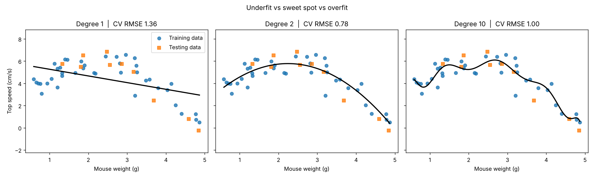

# Module 5 Lab: Bias, Variance and Cross-Validation in Python

This lab turns the Module 5 theory (train/test split, high bias vs high variance, K-fold cross-validation, model selection) into a short `scikit-learn` script.

## Scenario: predicting mouse running speed from weight

You measure the **weight** (g) and **top running speed** (cm/s) of 50 mice. The true relationship is curved:

```
speed = 2.0 + 3.5·weight − 0.8·weight² + noise
```

- Too simple a model (a straight line) misses the curve: **underfitting / high bias**.
- Too complex a model (a degree-10 polynomial) chases the noise: **overfitting / high variance**.

## Theory → code

| Concept | Meaning | In the code |
| :--- | :--- | :--- |
| Training vs testing set | Training data fits the model; testing data checks it on unseen data | `train_test_split(X, y, test_size=0.20, random_state=42)` |
| High bias (underfitting) | Too inflexible to capture the true pattern | `PolynomialFeatures(degree=1)` |
| High variance (overfitting) | Fits the training noise | `PolynomialFeatures(degree=10)` |
| Sweet spot | Balances bias and variance | `PolynomialFeatures(degree=2)` |
| K-fold cross-validation | Rotates validation blocks inside the training set to choose a model | `cross_val_score(model, X_train, y_train, cv=KFold(5, shuffle=True, random_state=42))` |

Each model is a pipeline: `StandardScaler → PolynomialFeatures → LinearRegression`. Scaling first keeps the degree-10 features (weight¹⁰ ≈ 10 million) numerically stable.

## How 5-fold CV works here

1. The 40 training samples are split into 5 folds of 8.
2. Iteration 1: folds 1–4 train, fold 5 validates. Iteration 2: folds 1–3 and 5 train, fold 4 validates. And so on.
3. The 5 validation errors are averaged.
4. The model with the **lowest average CV error** is selected: the script computes this, it isn't hard-coded.
5. Only then is the test set used, once, as a final check.

## Run it

```bash
pip install -r requirements.txt
python ml_practical_lesson.py
```

## Expected results

| Model | Training RMSE | 5-fold CV RMSE | Test RMSE |
|---|---|---|---|
| Degree 1 | 1.35 | 1.36 | 1.81 |
| **Degree 2 (selected)** | 0.72 | **0.78** | 0.80 |
| Degree 10 | 0.64 | 1.00 | 0.80 |

What to notice:

- **Degree 1** is worst everywhere: classic underfitting.
- **Degree 10** has the *lowest* training error but a clearly worse CV error than Degree 2. That gap between training and validation error is the overfitting signal.
- On this particular 10-sample test set, Degree 10 happens to score about the same as Degree 2. A single small test split is noisy, which is exactly why we choose models with cross-validation and not with one split.

The script also saves `bias_variance_fits.png` with the three fitted curves:



## Checklist

- [x] Never evaluate on training data alone.
- [x] Watch out for squiggly lines (overfitting).
- [x] Use K-fold cross-validation for model and hyperparameter selection.
- [x] Evaluate on the test set last, once.
