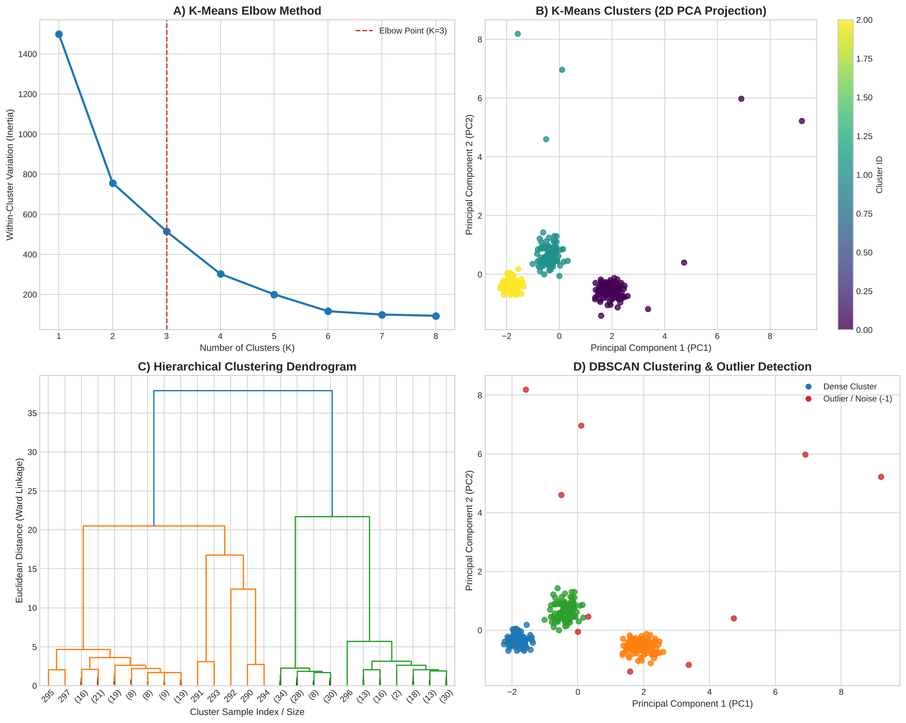

# Module 7: Unsupervised Learning Algorithms

← [Module 6](../module-06-supervised-learning) · [Course home](../README.md) · 📒 [Notes on Notion](https://chipped-willow-4a2.notion.site/41e6f1ed006e8106a164fa3c0390fa5b) · ▶️ [Module 7 playlist](https://www.youtube.com/playlist?list=PLEYTSV2T81_0) · Next: [Module 8](../module-08-deep-learning)

## What you'll learn

- Supervised vs unsupervised learning, and why scaling matters for distance-based methods
- K-means clustering and choosing K with the elbow plot
- Hierarchical clustering: Euclidean vs Manhattan distance, linkage methods, reading a dendrogram
- DBSCAN: epsilon, MinPts, core/border/noise points, and finding outliers
- PCA: principal components, loading scores, eigenvalues and scree plots
- Choosing the right method for the problem

## Videos

| # | Video | Type | Length |
|---|---|---|---|
| 1 | [The Unsupervised Learning Toolkit](https://youtu.be/fNh8WKElJpU) | Explainer | 6:55 |
| 2 | [Clustering Algorithms Explained](https://youtu.be/4g2nwCHgR1A) | Explainer | 11:15 |

## Hands-on lab

[code/customer_segmentation_lesson.py](code/customer_segmentation_lesson.py) segments 300 unlabelled shoppers into personas and flags suspicious accounts using PCA, K-means, hierarchical clustering and DBSCAN. See [code/README.md](code/README.md) for the walkthrough and expected results.

```bash
cd code
pip install -r requirements.txt
python customer_segmentation_lesson.py
```



| Method | Result |
|---|---|
| PCA | 2D view keeps 80.7% of the variation |
| K-means (K = 3) | Recovers the 3 personas, but forces the 10 anomalies into them |
| Hierarchical (Ward) | Agrees with K-means (Adjusted Rand Index 0.98) |
| DBSCAN (ε = 0.8) | Finds the 3 personas **and** flags exactly the 10 anomalies |

## Files

| File | Description |
|---|---|
| [code/customer_segmentation_lesson.py](code/customer_segmentation_lesson.py) | PCA, K-means, hierarchical and DBSCAN lab |
| [code/README.md](code/README.md) | Lab guide |
| [notes/Module_7_Unsupervised_Learning_Study_Guide.pdf](notes/Module_7_Unsupervised_Learning_Study_Guide.pdf) | Study guide |
| [notes/Module_7_Unsupervised_Learning_Reference_Notes.pdf](notes/Module_7_Unsupervised_Learning_Reference_Notes.pdf) | Reference notes and comparison matrix |
| [slides/Mapping_Dark_Data.pdf](slides/Mapping_Dark_Data.pdf) | Visual deck: Mapping the Dark Data |
| [slides/Clustering_and_PCA_Infographic.png](slides/Clustering_and_PCA_Infographic.png) | One-page infographic |

> **Note on the lab:** the original script saved its plot to a fixed `/workspace/scratch/` path (which crashes on most machines) and used DBSCAN with ε = 1.2, which merges two personas and misses 2 of the 10 anomalies. This version saves the plot locally and uses ε = 0.8. See the lab guide for details.
