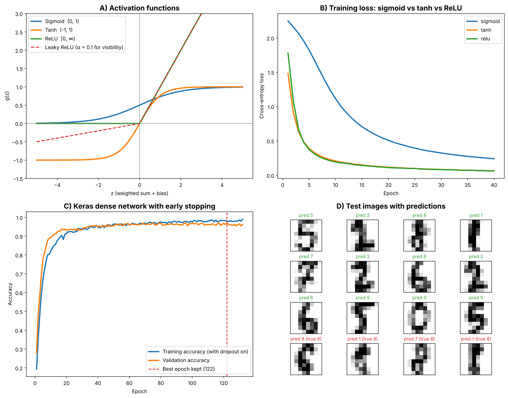

# Module 8: Deep Learning Basics

← [Module 7](../module-07-unsupervised-learning) · [Course home](../README.md) · 📒 [Notes on Notion](https://chipped-willow-4a2.notion.site/41e6f1ed006e81989a20f0e1404dcdcf) · ▶️ [Module 8 playlist](https://www.youtube.com/playlist?list=PLKeCiuH5RiLc) · Next: Module 9 (coming soon)

## What you'll learn

- What an artificial neuron computes: weighted sum + bias + activation
- Input, hidden and output layers, and counting a network's parameters
- Activation functions (sigmoid, tanh, ReLU, leaky ReLU, softmax) and why non-linearity matters
- Forward pass, loss, backpropagation and gradient descent, plus the vanishing gradient problem
- Optimisers: SGD, momentum, RMSprop and Adam
- Building networks in Keras, and where CNNs and RNNs/LSTMs fit in
- Fighting overfitting with dropout and early stopping, and deploying models responsibly

## Videos

| # | Video | Type | Length |
|---|---|---|---|
| 1 | [Deep Learning Anatomy](https://youtu.be/CFeDV1rHRjI) | Explainer | 11:11 |
| 2 | [The Architecture of Universal Approximation](https://youtu.be/BZVVAqg89G8) | Explainer | 7:47 |

## Hands-on lab

[code/neural_network_lesson.py](code/neural_network_lesson.py) teaches a network to read scikit-learn's handwritten digits (8 × 8 pixels). It builds the network **by hand in NumPy** (forward pass, softmax, cross-entropy, backprop, gradient check), races sigmoid against tanh and ReLU, then rebuilds it **in Keras** and adds a small CNN. See [code/README.md](code/README.md) for the walkthrough.

```bash
cd code
pip install -r requirements.txt
python neural_network_lesson.py
```

No install? The lab guide shows how to run it in Google Colab, where TensorFlow comes pre-installed.



| Model | Test accuracy |
|---|---|
| Guess the most common digit | 10.0% |
| NumPy network, sigmoid hidden layer | 93.3% |
| NumPy network, ReLU, built by hand | 96.9% |
| Keras dense network (Adam + dropout + early stopping) | 98.1% |
| **Keras small CNN** | **98.3%** |

## Files

| File | Description |
|---|---|
| [code/neural_network_lesson.py](code/neural_network_lesson.py) | Neural network from scratch in NumPy, then in Keras |
| [code/README.md](code/README.md) | Lab guide with results |
| [notes/Module_8_Deep_Learning_Study_Notes.pdf](notes/Module_8_Deep_Learning_Study_Notes.pdf) | Study notes |
| [slides/The_Deep_Learning_Schematic.pdf](slides/The_Deep_Learning_Schematic.pdf) | Visual deck: The Deep Learning Schematic |
| [slides/Deep_Learning_Basics_Infographic.png](slides/Deep_Learning_Basics_Infographic.png) | One-page infographic: the module at a glance |

> **Note on the notes:** in the optimiser table of the study notes PDF, the gradient symbol (∇) had dropped out of the SGD and momentum formulas. Both now read α·∇L.
