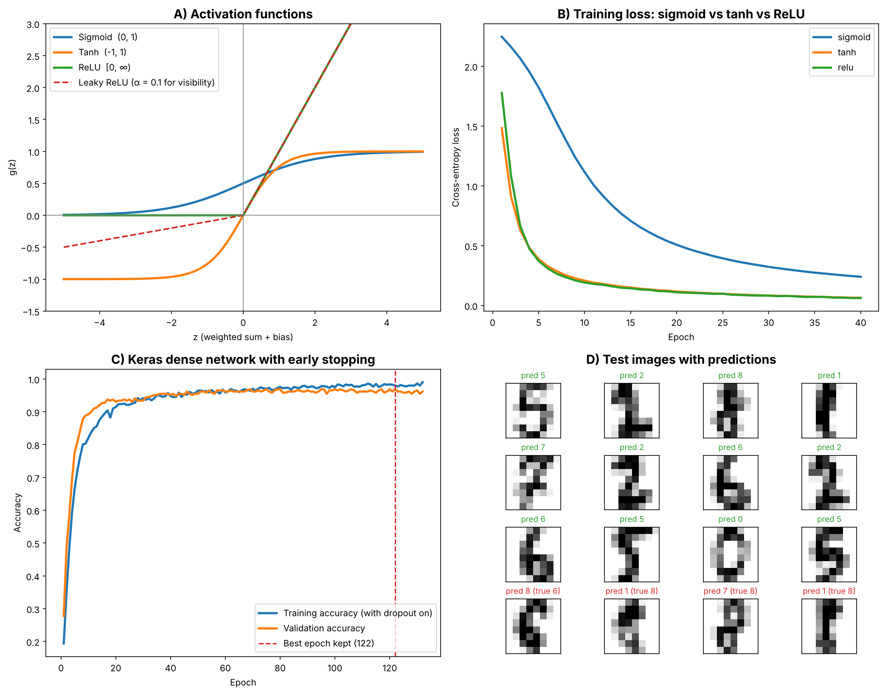

# Module 8 Lab: Teaching a Neural Network to Read Handwriting

This lab builds a neural network **twice**: once by hand in NumPy, so you see every multiplication, derivative and update, and once in Keras, so you see how much a framework does for you.

## The data

scikit-learn's **handwritten digits** dataset: 1,797 greyscale images of the digits 0 to 9, each 8 × 8 pixels. It ships with scikit-learn, so nothing is downloaded.

- Each image is flattened into **64 numbers** (one per pixel) and scaled from 0–16 to 0–1.
- 80% of the images (1,437) are used for training and 20% (360) are held back for testing.
- With 10 balanced classes, guessing the most common digit scores only **10%**. That's the baseline to beat.

## Run it

```bash
pip install -r requirements.txt
python neural_network_lesson.py
```

Parts 0–2 need only NumPy, scikit-learn and matplotlib, and run in a few seconds. Part 3 needs TensorFlow. If it isn't installed, Part 3 is skipped and the rest still runs. To run everything without installing anything, open [Google Colab](https://colab.research.google.com), which has TensorFlow pre-installed, and run:

```python
!wget -q https://raw.githubusercontent.com/prajwalskandas31-sudo/ai-engineering-course/main/module-08-deep-learning/code/neural_network_lesson.py
!python neural_network_lesson.py
```

## What each part teaches

### Part 0: Activation functions

| What it shows | Result |
|---|---|
| Sigmoid, tanh, ReLU and leaky ReLU at z = −5, −1, 0, 1, 5 | Sigmoid squashes to (0, 1), tanh to (−1, 1), ReLU cuts negatives to 0 |
| Largest slope of sigmoid | **0.25**, so through 10 sigmoid layers a gradient shrinks by at least 0.25¹⁰ ≈ 1 in a million (the *vanishing gradient*) |
| Slope of sigmoid at z = 5 | 0.0066: the neuron is *saturated* and barely learns |
| Two linear layers vs one combined layer | Identical outputs (difference 4 × 10⁻¹⁶). **Without a non-linear activation, extra layers add nothing.** |

### Part 1: A network from scratch in NumPy

Architecture: **64 inputs → 32 hidden neurons (ReLU) → 10 outputs (softmax)**, with 2,410 weights and biases to learn.

Each training step is the four-line loop from the lecture:

1. **Forward pass:** `z = XW + b`, then `a = g(z)` for every layer. Softmax turns the 10 output scores into probabilities.
2. **Loss:** cross-entropy, which punishes confident wrong answers hardest.
3. **Backward pass:** the chain rule, from the output layer back to the input. The code writes every derivative out in about ten lines.
4. **Update:** `W = W − learning_rate × gradient`.

Before training, a **gradient check** nudges individual weights up and down and measures the change in loss numerically. It matches the backprop gradients to a relative error of about 5 × 10⁻⁹, which proves the calculus in the code is right.

| Epoch | Loss | Train accuracy |
|---|---|---|
| 1 | 0.884 | 78.4% |
| 10 | 0.068 | 97.8% |
| 40 | 0.007 | 99.9% |

**Test accuracy: 96.9%**, against a 10% baseline. The gap between 99.9% on training and 96.9% on test is a small amount of overfitting, which Part 3 tackles.

### Part 2: Sigmoid vs tanh vs ReLU

The same network is trained three times, changing only the hidden-layer activation (40 epochs, learning rate 0.1):

| Activation | Loss after 5 epochs | Final loss | Test accuracy |
|---|---|---|---|
| Sigmoid | 1.823 | 0.240 | 93.3% |
| Tanh | 0.389 | 0.064 | 96.9% |
| ReLU | 0.373 | 0.063 | 96.7% |

Sigmoid is far behind after 5 epochs. Its slope is never above 0.25 and its output is not centred on zero, so the gradients it passes back are weak. Tanh and ReLU learn about equally fast here. ReLU is the usual default in deeper networks because it never saturates for positive inputs and is cheaper to compute.

### Part 3: The same ideas in Keras

**Model 1: Dense network.** It has the same shape as Part 1 (64 → 32 ReLU → 10 softmax), so it has the same 2,410 parameters. The hundred lines of NumPy become four lines of Keras:

```python
model = keras.Sequential([
    keras.Input(shape=(64,)),
    keras.layers.Dense(32, activation="relu"),
    keras.layers.Dropout(0.2),
    keras.layers.Dense(10, activation="softmax"),
])
model.compile(optimizer="adam", loss="sparse_categorical_crossentropy", metrics=["accuracy"])
model.fit(X_train, y_train, validation_split=0.2, epochs=200, callbacks=[early_stop])
```

Keras adds three things from the lecture that the NumPy version lacks:

- **Adam optimiser:** each weight gets its own adaptive step size, combining momentum and RMSprop.
- **Dropout (20%):** a random fifth of the hidden neurons is switched off on every training step, so the network can't rely on any single neuron.
- **Early stopping:** 20% of the training images are held back for validation. Training stops when validation loss hasn't improved for 10 epochs, and the best weights are restored.

Training stopped after 132 of 200 epochs and kept the weights from epoch 122. **Test accuracy: 98.1%**, up from 96.9% for the hand-built version.

In plot C, the training accuracy sits *below* validation accuracy for the first 30 or so epochs. That isn't a bug: dropout is only active during training, so the training score is measured on a deliberately handicapped network.

**Model 2: Small CNN.** Instead of treating each image as 64 loose numbers, the CNN keeps it as an 8 × 8 grid and slides 3 × 3 filters over it:

`Conv2D(16) → MaxPooling2D → Conv2D(32) → Flatten → Dropout(0.3) → Dense(10)`

It has 9,930 parameters and trained for 56 epochs. **Test accuracy: 98.3%**, the best of all the models. It gets 354 of the 360 test images right. Three of the four misses shown in plot D are 8s, the digit whose loops are hardest to see at 8 × 8 pixels.

| Model | Test accuracy |
|---|---|
| Majority-class baseline | 10.0% |
| NumPy network, sigmoid (Part 2) | 93.3% |
| NumPy network, ReLU, built by hand (Part 1) | 96.9% |
| Keras dense network (Adam + dropout + early stopping) | 98.1% |
| **Keras small CNN** | **98.3%** |

> TensorFlow prints a few start-up log lines (for example "Could not find cuda drivers… GPU will not be used"). They're harmless: it just means you're running on a CPU.

## The plot

`deep_learning_master_plot.png` is saved in the folder you run the script from:

- **A:** the four activation functions
- **B:** training loss per epoch for sigmoid, tanh and ReLU
- **C:** Keras training vs validation accuracy, with the epoch early stopping kept
- **D:** test images with the CNN's predictions (green = right, red = wrong)



## Try it yourself

1. **Remove the non-linearity.** In `NumpyMLP.__init__`, add a `"linear"` option where `g(z) = z` and `g'(z) = 1`. How close does test accuracy get to plain logistic regression (95.6% on this split)? The digits are nearly separable by straight lines, so the gap is small here. On harder data such as photos, it is huge.
2. **Learning rate.** Train Part 1 with `lr=0.01` and `lr=5.0`. What happens to the loss in each case?
3. **Width.** Change the hidden layer from 32 to 8 or to 128 neurons. Count the parameters each time and compare test accuracy.
4. **Dropout.** In the Keras dense model, set dropout to 0 and then to 0.5. Watch the gap between training and validation accuracy in plot C.
5. **Sigmoid with a bigger step.** Rerun Part 2 with `lr=0.5`. Does sigmoid catch up? (A bigger step partly makes up for small gradients.)
