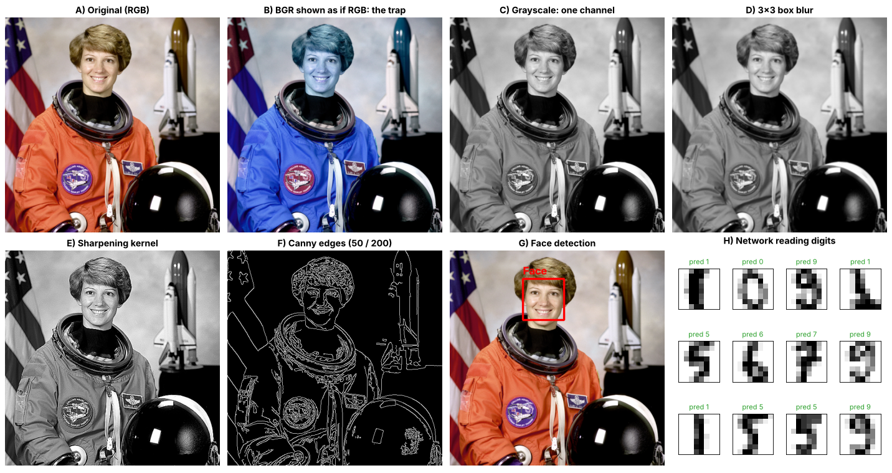

# Module 9: Computer Vision

← [Module 8](../module-08-deep-learning) · [Course home](../README.md) · 📒 [Notes on Notion](https://chipped-willow-4a2.notion.site/41e6f1ed006e818dbad4cc2fcbc0775e) · ▶️ [Module 9 playlist](https://www.youtube.com/playlist?list=PLI87agNzVTHQ) · Next: [Module 10](../module-10-nlp) →

[](https://colab.research.google.com/github/prajwalskandas31-sudo/ai-engineering-course/blob/main/module-09-computer-vision/Module_9_Lab.ipynb) **Run this module's lab in your browser** with Google Colab: no installs needed. Notebook: [Module_9_Lab.ipynb](Module_9_Lab.ipynb) · 📄 Step-by-step [code walkthrough with real outputs (PDF)](Module_9_Code_Walkthrough.pdf)

## What you'll learn

- Computer vision vs image processing vs computer graphics
- How images are stored: arrays, grayscale, RGB and OpenCV's BGR order
- OpenCV essentials: reading, converting, resizing, drawing
- Convolution filters (blur, sharpen) and Canny edge detection
- Face detection vs recognition, Haar cascades and face embeddings
- How a neural network reads digits, and how YOLO detects objects in one pass

## Videos

| # | Video | Type | Length |
|---|---|---|---|
| 1 | [Pixels to Recognition](https://youtu.be/TA0p_pTGvqc) | Explainer | 7:56 |
| 2 | [Deep Learning, Computer Vision & NLP: Live Class (Modules 8–10)](https://youtu.be/pSryVIuYQl8) | Class Recording | 2:21:17 |

## Hands-on lab

[code/computer_vision_lesson.py](code/computer_vision_lesson.py) walks one photo from raw numbers to a detected face, then trains a small digit-reading network and shows why shifting a digit by one pixel breaks it. See [code/README.md](code/README.md) for the walkthrough.

```bash
cd code
pip install -r requirements.txt
python computer_vision_lesson.py
```



## Files

| File | Description |
|---|---|
| [code/computer_vision_lesson.py](code/computer_vision_lesson.py) | OpenCV lab: arrays, filters, edges, face detection, digit network, optional YOLO |
| [code/README.md](code/README.md) | Lab guide with results |
| [notes/Module_9_Computer_Vision_Notes.pdf](notes/Module_9_Computer_Vision_Notes.pdf) | Study notes |
| [slides/From_Pixels_to_Perception.pdf](slides/From_Pixels_to_Perception.pdf) | Visual deck: From Pixels to Perception |
| [slides/Visual_Computing_Infographic.png](slides/Visual_Computing_Infographic.png) | Infographic: vision vs processing vs graphics |
