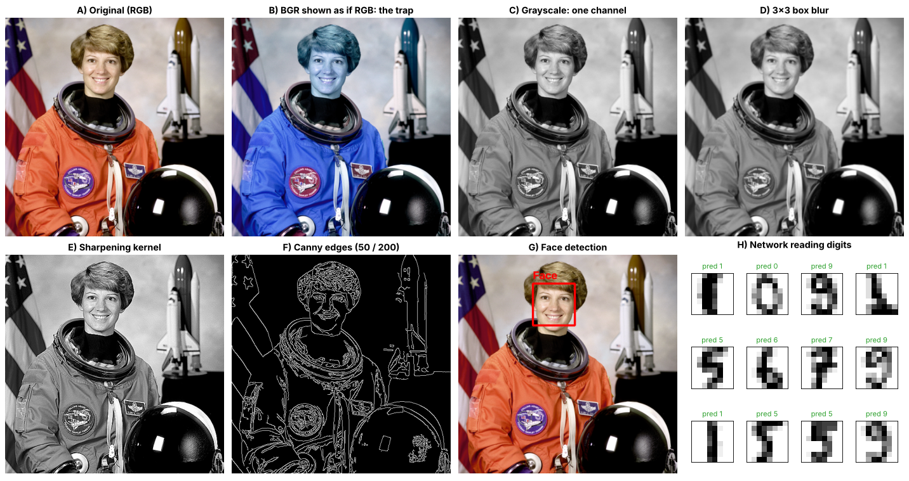

# Module 9 Lab: From Pixels to Perception

This lab takes one photo and walks it from raw numbers to a detected face, then teaches a small neural network to read digits and shows where it breaks. Every image ships with scikit-image, so nothing is downloaded (except the optional YOLO model in Part 5).

## Run it

```bash
pip install -r requirements.txt
python computer_vision_lesson.py
```

Or open it in Google Colab, with no installs: [Module_9_Lab.ipynb](https://colab.research.google.com/github/prajwalskandas31-sudo/ai-engineering-course/blob/main/module-09-computer-vision/Module_9_Lab.ipynb). Colab is also the easiest place to try the optional YOLO part.

## What each part shows

### Part 1: An image is a grid of numbers

| Check | Result |
|---|---|
| Colour photo shape | `(512, 512, 3)`: height × width × 3 channels = **786,432** numbers |
| Data type | `uint8`: whole numbers from 0 to 255 |
| Grayscale shape | `(512, 512)`: one channel, a third of the numbers |
| One pixel, BGR vs RGB | B=25, G=41, R=41 in OpenCV's order; the same pixel is R=41, G=41, B=25 in RGB |

**The BGR trap:** one patch of the photo averages R=168, G=87, B=96 (reddish). Read the same three numbers in the wrong order and you get R=96, B=168 (bluish). That's why an OpenCV image shown with Matplotlib turns red things blue (panel B of the plot). Always convert with `cv2.cvtColor(img, cv2.COLOR_BGR2RGB)`.

### Part 2: Image processing (image in, modified image out)

- **Resizing:** `INTER_AREA` to shrink (512 → 256), `INTER_CUBIC` to enlarge (512 → 1024).
- **Convolution with `cv2.filter2D`:** a 3 × 3 box blur (every weight 1/9) and a sharpening kernel (centre +5, neighbours −1).

| Image | Sharpness (variance of the Laplacian) |
|---|---|
| Original | 861 |
| 3 × 3 blur | 93: fine detail smoothed away |
| Sharpened | 11,624: edges exaggerated |

- **Canny edges:** thresholds 50/200 mark 9.3% of pixels as edges; 20/60 marks 14.6%. Lower thresholds keep weaker edges.

### Part 3: Face detection (where is the face?)

A cascade detector finds **1 face** and the lab draws a red box and label on it with `cv2.rectangle` and `cv2.putText`. In Colab this uses OpenCV's Haar cascade (`haarcascade_frontalface_default.xml`). If your OpenCV build doesn't include cascades, the lab falls back to scikit-image's LBP cascade, which works the same way.

Rotate the photo 90° and the cascade finds **0** faces: classical cascades expect upright, frontal faces.

Detection only answers *where*. Recognition (*whose* face) would crop this box and compare a 128-number face embedding against known people.

### Part 4: A network that reads digits, and its blind spot

A **64 → 16 → 16 → 10** network (the 8 × 8 version of the 784 → 16 → 16 → 10 network from class) has 1,482 weights and biases.

| Test digits | Accuracy |
|---|---|
| As drawn | **96.2%** |
| Shifted 1 pixel right | 39.8% |
| Shifted 2 pixels right | 15.3% |

A dense network ties each weight to one pixel position, so a tiny shift lights up the "wrong" pixels. CNNs and YOLO slide the same filters across the whole image, which is why they handle this.

### Part 5 (optional): YOLOv8 object detection

With `ultralytics` installed (`!pip install ultralytics` in Colab), a pre-trained YOLOv8n model looks at a photo **once** and returns every object's box, class and confidence. The lab prints them and draws them in panel H.

## The plot

`computer_vision_master_plot.png`: A) original, B) the BGR trap, C) grayscale, D) blur, E) sharpen, F) Canny edges, G) face detection, H) the network's digit predictions (or the YOLO detections, if you ran Part 5).



## Try it yourself

1. Change the Canny thresholds and watch the edge percentage.
2. Make the blur kernel 7 × 7 (`np.ones((7, 7)) / 49`). What happens to the sharpness score?
3. In `detect_faces`, try `minNeighbors=1` and `minNeighbors=10`. When do you get false alarms?
4. Train the digit network on shifted images too (data augmentation) and re-test the shifted digits.
