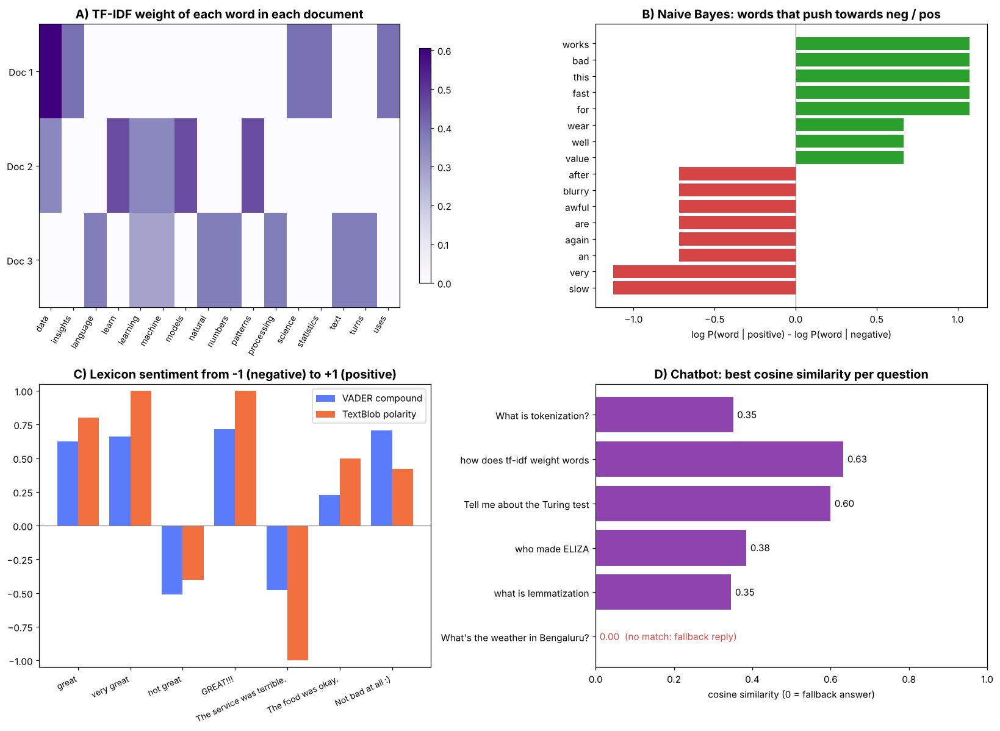

# Module 10: Natural Language Processing (NLP)

← [Module 9](../module-09-computer-vision) · [Course home](../README.md) · 📒 [Notes on Notion](https://chipped-willow-4a2.notion.site/41e6f1ed006e8190a4b8f73406ae9a07) · ▶️ [Module 10 playlist](https://www.youtube.com/playlist?list=PLCpq4dWJGmXA) · 🎓 Final module

[](https://colab.research.google.com/github/prajwalskandas31-sudo/ai-engineering-course/blob/main/module-10-nlp/Module_10_Lab.ipynb) **Run this module's lab in your browser** with Google Colab: no installs needed. Notebook: [Module_10_Lab.ipynb](Module_10_Lab.ipynb) · 📄 Step-by-step [code walkthrough with real outputs (PDF)](Module_10_Code_Walkthrough.pdf)

## What you'll learn

- The NLP pipeline: clean, tokenize, remove stop words, reduce words to roots, vectorize
- Regex cleaning and tokenization, and why removing stop words can delete "not"
- Stemming (Porter, Lancaster, Snowball) vs lemmatization (WordNet)
- Bag of Words, n-grams and TF-IDF, and measuring similarity with cosine similarity
- Naive Bayes text classification, and sentiment scores with VADER and TextBlob
- Chatbots from ELIZA and the Turing test to a TF-IDF retrieval chatbot

## Videos

| # | Video | Type | Length |
|---|---|---|---|
| 1 | [Demystifying NLP](https://youtu.be/AiFxDvjZdfU) | Explainer | 7:50 |
| 2 | [Deep Learning, Computer Vision & NLP: Live Class (Modules 8–10)](https://youtu.be/pSryVIuYQl8) | Class Recording | 2:21:17 |
| 3 | [From Raw Text to a Chatbot (lab walkthrough)](https://youtu.be/HyokrRFsnIA) | Lab Walkthrough | 8:21 |

## Hands-on lab

[code/nlp_lesson.py](code/nlp_lesson.py) takes raw reviews through cleaning and tokenizing, compares stemmers with a lemmatizer, turns text into TF-IDF vectors, trains a Naive Bayes sentiment classifier, scores phrases with VADER and TextBlob, and finishes with a small retrieval chatbot. See [code/README.md](code/README.md) for the walkthrough.

```bash
cd code
pip install -r requirements.txt
python nlp_lesson.py
```



## Files

| File | Description |
|---|---|
| [code/nlp_lesson.py](code/nlp_lesson.py) | NLP lab: preprocessing, stemming vs lemmatization, TF-IDF, Naive Bayes, VADER, retrieval chatbot |
| [code/README.md](code/README.md) | Lab guide with results |
| [notes/Module_10_NLP_Notes.pdf](notes/Module_10_NLP_Notes.pdf) | Study notes |
| [slides/The_Digital_Refinery.pdf](slides/The_Digital_Refinery.pdf) | Visual deck: The Digital Refinery |
| [slides/NLP_Infographic.png](slides/NLP_Infographic.png) | Infographic: the NLP pipeline on one page |
