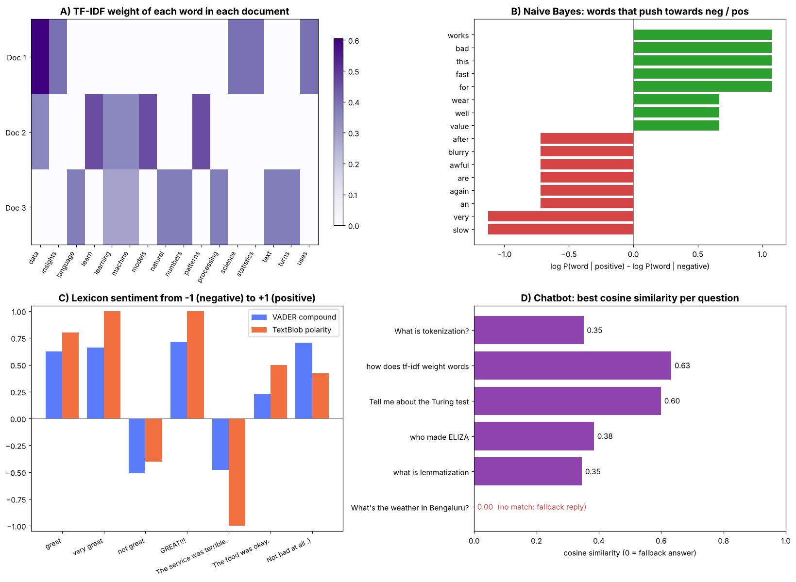

# Module 10 Lab: From Raw Text to a Chatbot

This lab walks short product and movie reviews through the whole NLP pipeline, then builds a chatbot that answers questions about NLP. All the text is written into the script, so nothing is downloaded (NLTK fetches its small WordNet and VADER word lists the first time).

## Run it

```bash
pip install -r requirements.txt
python nlp_lesson.py
```

Or open it in Google Colab, with no installs: [Module_10_Lab.ipynb](https://colab.research.google.com/github/prajwalskandas31-sudo/ai-engineering-course/blob/main/module-10-nlp/Module_10_Lab.ipynb). Parts 2 and 5 need `nltk` and `textblob`; if they're missing, those parts are skipped and the rest still runs.

## What each part shows

### Part 1: Cleaning and tokenizing

`"WOW!!! The battery LASTS forever... but the Screen? Not great, honestly :("` becomes 11 lowercase tokens, then 7 after removing stop words. **"not" disappears with them**, so "not great" turns into "great". Keep negations for sentiment work.

Across the 34 training reviews, the vocabulary shrinks from 167 space-separated "words" to 149 after lowercasing and removing punctuation, and to 114 without stop words.

### Part 2: Stemming vs lemmatization (NLTK)

| Word | Porter | Lancaster | Snowball | Lemma (with POS) | Lemma (no POS) |
|---|---|---|---|---|---|
| computing | comput | comput | comput | compute | computing |
| studies | studi | study | studi | study | study |
| hobbies | hobbi | hobby | hobbi | hobby | hobby |
| better | better | bet | better | good | better |
| running | run | run | run | run | running |
| geese | gees | gees | gees | goose | goose |

Stems can be non-words; lemmas are real words, but only when you pass the part of speech (`pos='v'` for verbs, `pos='a'` for adjectives). Stem for fast classification, lemmatize for anything a person reads.

### Part 3: Text into numbers

- **Bag of Words** on three short documents: a 3 × 16 matrix that is 60% zeros. Adding bigrams doubles the vocabulary to 32.
- **TF-IDF:** 'data' and 'learning' (each in 2 of 3 documents) get IDF 1.29; 'statistics' and 'text' (1 document) get 1.69. Rarer words carry more weight.
- **Cosine similarity:** the query "how do machines learn from data" scores 0.366, **0.577** and 0.000 against the three documents, so it matches "Machine learning models learn patterns from data."

### Part 4: Naive Bayes sentiment classifier

`MultinomialNB` with Laplace smoothing (`alpha=1`), trained on 34 labelled reviews, gets **5 of 6** unseen reviews right with unigrams, and the same with bigrams added (147 → 339 features).

The miss is instructive: **"This is not good at all" comes out positive (P = 0.95)**. Common words like "this" and "at all" outvote a single "not good" training example. And "bad" shows up among the *positive* words, because it only appears in "not bad" reviews. Naive Bayes counts words without context; more data, or lexicons that handle negation, fix this.

### Part 5: Lexicon sentiment (VADER and TextBlob)

| Text | VADER compound | TextBlob polarity |
|---|---|---|
| great | 0.625 | 0.80 |
| very great | 0.659 | 1.00 |
| not great | −0.510 | −0.40 |
| GREAT!!! | 0.716 | 1.00 |
| The service was terrible. | −0.477 | −1.00 |
| The food was okay. | 0.226 | 0.50 |
| Not bad at all :) | 0.705 | 0.42 |

Both boost "very" and flip "not". VADER also reacts to CAPITALS and "!!!", and reads "Not bad at all :)" as clearly positive. Its cut-offs: compound ≥ 0.05 positive, ≤ −0.05 negative, otherwise neutral.

### Part 6: A retrieval chatbot

The bot holds a 14-sentence knowledge base about NLP (109 distinct words). For each question it:

1. Says goodbye on "bye", and replies to greetings ("hello", "hi", "hey") with a random greeting.
2. Turns the question and every sentence into TF-IDF vectors.
3. Replies with the sentence that has the highest cosine similarity.
4. Falls back to "I am sorry! I don't understand you." when the best similarity is 0.

| Question | Best similarity |
|---|---|
| What is tokenization? | 0.35 |
| how does tf-idf weight words | 0.63 |
| Tell me about the Turing test | 0.60 |
| who made ELIZA | 0.38 |
| what is lemmatization | 0.35 |
| What's the weather in Bengaluru? | 0.00 → fallback |

To chat with it yourself, run `while (q := input('You: ')) != 'bye': print('Bot:', bot.reply(q)[0])` after creating `bot = RetrievalChatbot(KNOWLEDGE)`.

## The plot



## Try this

- Add "Not good, I would not buy it again." and two more "not good" reviews to `REVIEWS` and re-run Part 4. Does "This is not good at all" flip?
- Remove `stop_words="english"` from the chatbot's `TfidfVectorizer` and ask the same questions. Which answers change?
- Add a sentence about Siri or transformers to `KNOWLEDGE`, then ask about it.
